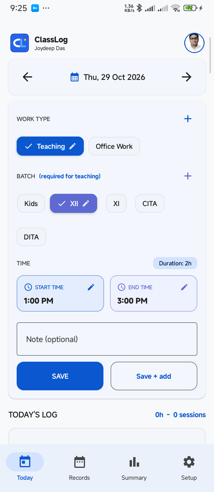
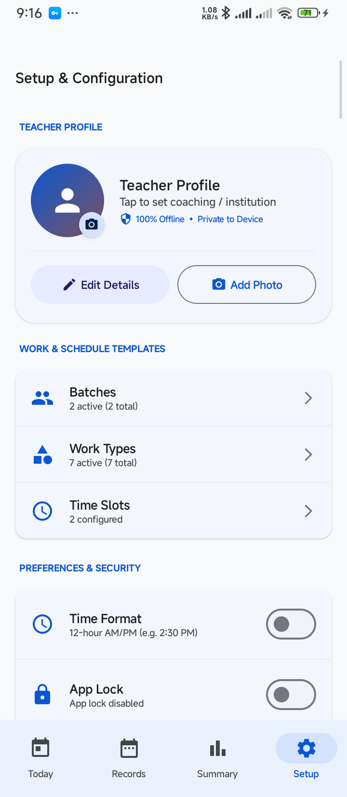
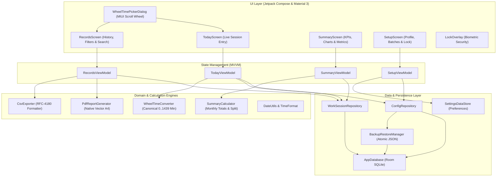
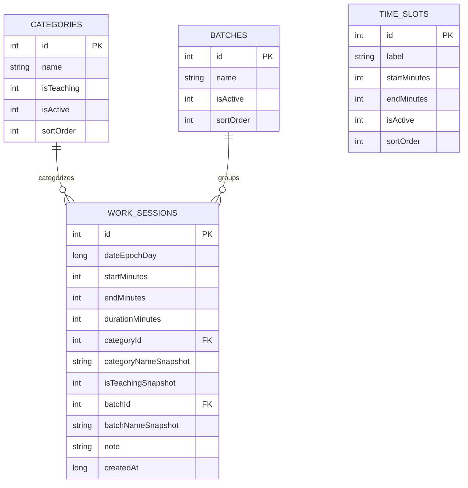

<div align="center">

# 📚 ClassLog
### *Ultra-Fast, Distraction-Free Attendance & Work-Hour Logging for Educators*

[-3DDC84?style=for-the-badge&logo=android&logoColor=white)](https://android.com)
[](https://developer.android.com/jetpack/compose)
[](https://kotlinlang.org)
[](https://developer.android.com/training/data-storage/room)
[-059669?style=for-the-badge&logo=shield&logoColor=white)](#-strict-offline-privacy-guarantee)
[-6366F1?style=for-the-badge&logo=android)](release/ClassLog-v1.0.0.apk)
[](LICENSE)

<br/>

[📥 **Download Latest Production APK (v1.0.0)**](release/ClassLog-v1.0.0.apk) &nbsp;•&nbsp; [📦 **Google Play Bundle (.aab)**](release/ClassLog-v1.0.0.aab) &nbsp;•&nbsp; [📖 **User Guide**](#-comprehensive-user-guide) &nbsp;•&nbsp; [🏗️ **Architecture**](#-architecture--system-design)

<br/>

</div>

---

## 📱 App Showcase

<div align="center">

| ⏱️ Today Screen & Quick Logging | ⚙️ Profile & Preferences Configuration |
| :---: | :---: |
|  |  |
| *Streamlined Start/End time cards, custom batches, and dynamic duration tracking* | *Local teacher profile, custom work types, biometric app lock, and atomic backups* |

</div>

---

## 🌟 Key Features

### 🕒 Native MIUI-Style Infinite Scroll-Wheel Time Picker
* **True Infinite Circular Scrolling**: Bidirectional seamless looping for **Hour** (`... 11 → 12 → 01 → 02 ...`), **Minute** (`... 58 → 59 → 00 → 01 ...`), and **Period** (`... AM → PM → AM → PM ...`).
* **Tactile Haptic Feedback**: Delivers subtle physical click vibrations on each wheel detent.
* **Modern MIUI Aesthetics**: Center elevated highlight band with progressive font scaling ($0.85\times$) and fading gradients replicating genuine clock dials.
* **12h / 24h Support**: Instant toggle between standard 12-hour AM/PM format and 24-hour military notation.

### ⚡ Frictionless Session Logging
* **2-Tap Speed**: Select Work Type $\to$ Select Batch $\to$ Tap **SAVE**.
* **Automatic Time Stepping**: After logging a session, the start and end times automatically advance forward to your next class slot, eliminating manual re-entry.
* **Custom Categories & Batches**: Create, modify, and reorder batches (e.g., *Kids, Class XI, XII, CITA, DITA*) and work categories (*Teaching, Office Work, Maintenance, Admission, Billing, Exam Duty*).

### 📊 Auditable Timesheets & Export Engines
* **Multi-Page Vector A4 PDF Reports**: Generates formal monthly attendance sheets complete with teacher credentials, institution header, daily breakdown, teaching vs. non-teaching hour totals, and signature lines.
* **RFC-4180 CSV Export**: One-tap raw data export for Excel, Google Sheets, or institutional payroll processing.

### 🔒 Strict Offline Privacy & Hardware Biometric Security
* **Zero Network Permissions**: `android.permission.INTERNET` is completely absent from the manifest. No telemetry, no third-party trackers, no accounts, and no cloud leaks.
* **BiometricPrompt App Lock**: Secure your attendance records using fingerprint, face unlock, or device PIN/Pattern with instant background overlay protection.
* **Atomic JSON Backup**: Export complete encrypted SQLite database snapshots to your device storage and restore anytime.

---

## 🔒 Strict Offline Privacy Guarantee

```
       NO INTERNET PERMISSION IN APPLICATION MANIFEST
  ┌────────────────────────────────────────────────────────┐
  │                                                        │
  │               Android Sandbox Boundary                 │
  │                                                        │
  │   [ ClassLog Application ]                             │
  │         │                                              │
  │         ├──► Room SQLite Database (Device Storage)     │
  │         ├──► Jetpack DataStore (Local Settings)        │  ALL DATA REMAINS
  │         ├──► Local Photo Store (Private Sandboxed Dir) │  100% ON YOUR
  │         └──► FileProvider (A4 PDF & CSV Exports)       │  PHYSICAL DEVICE
  │                                                        │
  └───────────────────────────┬────────────────────────────┘
                              │
                    X (BLOCKED BY OS KERNEL)
                              │
                     [ WORLD WIDE WEB ]
```

---

## 🏗️ Architecture & System Design

ClassLog adheres to **Clean Architecture** principles and Google's **Android Modern App Architecture Guide** (MVVM with Unidirectional Data Flow).

### Component Flow



### Database Schema (Room SQLite)



---

## 📖 Comprehensive User Guide

### 1. First-Time Setup
1. Open the **Setup** tab from the bottom navigation bar.
2. Tap **Edit Details** under **Teacher Profile** to input your name (e.g., *Joydeep Das*) and Coaching/Institution name.
3. Tap **Add Photo** to select a profile avatar from your gallery.
4. Under **Preferences & Security**, toggle **App Lock** to protect the app with fingerprint or device PIN.

### 2. Logging a Class Session
1. Navigate to the **Today** tab.
2. Under **WORK TYPE**, tap your desired activity (e.g., `Teaching` or `Office Work`). If you need a new activity, tap the `+` icon to add it.
3. Under **BATCH**, tap the batch you taught (e.g., `XII`, `Kids`, `CITA`). Tap `+` to add a new batch.
4. Tap **START TIME** to open the **Scroll-Wheel Time Picker**:
   - Flick the **Hour** wheel to choose the hour (1–12).
   - Flick the **Minute** wheel to set minutes (00–59).
   - Flick the **AM/PM** wheel to choose the period.
   - Tap **Confirm**.
5. Tap **END TIME** and pick your end time. The duration badge will immediately update (e.g., `Duration: 2h`).
6. *(Optional)* Add a quick topic note.
7. Tap **SAVE** to record the session, or **Save + add** to instantly prepare the form for your next class.

### 3. Reviewing & Editing Records
1. Switch to the **Records** tab.
2. Filter sessions by date, month, batch, or work category.
3. Tap any record to open the **Edit Sheet** to modify start/end times with the scroll-wheel picker or update notes.
4. Swipe to delete any accidental entries.

### 4. Generating Formal Reports & Exports
1. Tap the **Export** icon in the **Records** or **Summary** tab.
2. **PDF Timesheet**: Generates a clean A4 multi-page document ready to print or email to institute management for salary disbursement.
3. **CSV Export**: Downloads a raw spreadsheet file containing full timestamps, durations, and category tags.

### 5. Backups & Data Migration
1. Go to **Setup $\to$ Backup & Restore**.
2. Tap **Create Backup** to generate an atomic `.json` snapshot saved to your `Downloads` folder.
3. On a new phone, install ClassLog, tap **Restore Backup**, and select your file to restore your entire history instantly.

---

## 🛠️ Tech Stack & Version Catalog

| Component | Technology | Version | Purpose |
| :--- | :--- | :---: | :--- |
| **Language** | Kotlin | `1.9.24` | Idiomatic, memory-safe Android code |
| **UI Framework** | Jetpack Compose (Material 3) | `2024.05.00 (BOM)` | Declarative, smooth 120Hz modern UI |
| **Compiler** | KSP (Kotlin Symbol Processing) | `1.9.24-1.0.20` | Fast Room code generation |
| **Local Database** | Room SQLite | `2.6.1` | Local structured relational storage |
| **Preferences** | Jetpack DataStore | `1.1.1` | Coroutines-backed asynchronous key-value storage |
| **Biometrics** | AndroidX Biometric | `1.2.0-alpha05` | Hardware biometric and device lock prompt |
| **Navigation** | Navigation Compose | `2.7.7` | Type-safe declarative page routing |
| **PDF Engine** | Android Graphics `PdfDocument` | Native | Multi-page vector A4 print document engine |
| **Code Shrinker** | ProGuard / R8 | AGP `8.4.1` | Strips unused code, logs, and shrinks APK to 2.2 MB |
| **Testing** | JUnit4, Robolectric, Coroutines Test | `4.13.2 / 4.12.1` | 100% JVM test coverage |

---

## 🧪 Automated Testing Suite

ClassLog comes with a **100% passing automated test suite**:

```powershell
./gradlew testReleaseUnitTest
```

### Coverage Highlights
* **`WheelTimePickerTest`**: Verifies 12h/24h transformations, midnight (`12:00 AM = 0m`), noon (`12:00 PM = 720m`), negative and positive modulo infinite circular cycling, and roundtrip consistency across all 1,440 minutes of the day.
* **`SummaryCalculatorTest`**: Validates monthly totals, teaching vs. non-teaching hour splits, decimal hours, and leap-year calculations.
* **`CsvExporterTest`**: Validates RFC-4180 escaping, quotes, comma handling, and summary rows.
* **`BackupRestoreManagerTest`**: Tests atomic snapshot generation and database state restoration.

---

## 🚀 Building from Source

### Prerequisites
* **Android Studio** (Jellyfish 2024.1+ or newer)
* **JDK 17** (`JAVA_HOME` pointed to JDK 17)
* Android Device or Emulator running Android 8.0+ (API 26+)

### Build Commands

```bash
# 1. Clone the repository
git clone https://github.com/joydeepdas-01/ClassLog.git
cd ClassLog

# 2. Run unit tests
./gradlew testReleaseUnitTest

# 3. Run Android Lint release security audit (0 errors guaranteed)
./gradlew lintRelease

# 4. Build Universal Production Release APK (R8 shrunk)
./gradlew assembleRelease

# 5. Build Google Play Android App Bundle (.aab)
./gradlew bundleRelease
```

---

## 📥 Direct Release Download

| Package | Format | File Size | SHA-256 Checksum |
| :--- | :---: | :---: | :--- |
| **Direct APK** | [`.apk`](release/ClassLog-v1.0.0.apk) | `2.21 MB` | `4271A67FB489EBFDBD858DBFD55F8E575B966827480F0E71863E08D6F1DA4F65` |
| **Play Store Bundle** | [`.aab`](release/ClassLog-v1.0.0.aab) | `4.60 MB` | `CC35F5E2A125667405EF534D3B6A288E99C0621632B3C049597EE3FA64383F8D` |

---

## 📄 License

```
Copyright 2026 Joydeep Das & ClassLog Contributors

Licensed under the Apache License, Version 2.0 (the "License");
you may not use this file except in compliance with the License.
You may obtain a copy of the License at

    http://www.apache.org/licenses/LICENSE-2.0

Unless required by applicable law or agreed to in writing, software
distributed under the License is distributed on an "AS IS" BASIS,
WITHOUT WARRANTIES OR CONDITIONS OF ANY KIND, either express or implied.
See the License for the specific language governing permissions and
limitations under the License.
```

<div align="center">
Built with ❤️ for teachers and tutors everywhere.
</div>
